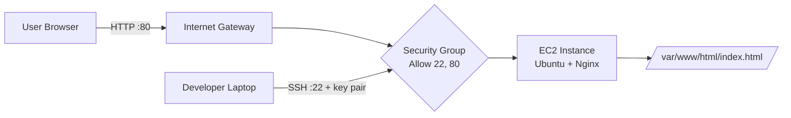

# EC2-Based Web Server: Nginx on Ubuntu (AWS)

> Deploying a production-style web server on Amazon EC2 using Ubuntu and Nginx, built from scratch with the AWS Management Console and the Linux command line.


---

## Table of Contents

1. [Project Overview](#1-project-overview)
2. [What I Learned](#2-what-i-learned)
3. [Architecture](#3-architecture)
4. [Core Concepts Explained](#4-core-concepts-explained)
5. [Tech Stack](#5-tech-stack)
6. [Prerequisites](#6-prerequisites)
7. [Step-by-Step Implementation](#7-step-by-step-implementation)
8. [Verification and Testing](#8-verification-and-testing)
9. [Useful Nginx and System Commands](#9-useful-nginx-and-system-commands)
10. [Troubleshooting](#10-troubleshooting)
11. [Security Considerations](#11-security-considerations)
12. [Cost and Cleanup](#12-cost-and-cleanup)
13. [Challenges Faced](#13-challenges-faced)
14. [Future Improvements](#14-future-improvements)
15. [Project Structure](#15-project-structure)
16. [Author](#16-author)

---

## 1. Project Overview

This project demonstrates how to host a website on a cloud virtual machine instead of using a managed hosting service. I launched an **Amazon EC2** instance running **Ubuntu**, installed **Nginx**, opened the right network ports with a **Security Group**, and served a custom HTML page to the public internet.

**What the project covers**

- Provisioning a virtual server in the AWS cloud
- Securing access using key pairs and security groups
- Connecting to a remote Linux server over SSH
- Installing and managing a service with `apt` and `systemd`
- Serving static web content with Nginx
- Making the service survive reboots
- Testing, debugging, and cleaning up cloud resources

**Why this matters**

This is the foundation of how real websites, web applications, APIs, and reverse proxies are deployed. Every higher-level service (load balancers, containers, CI/CD pipelines) builds on these same basics.

---

## 2. What I Learned

| Area | Skill gained |
|---|---|
| Cloud | Launching and managing EC2 instances, AMIs, instance types |
| Networking | Security groups, ports 22 and 80, public IPs, inbound rules |
| Linux | SSH, file permissions, package management, `systemctl`, log files |
| Web servers | Nginx installation, default document root, serving static files |
| Security | Key-based authentication, least-privilege access, restricting SSH |
| Troubleshooting | Reading service status and logs, diagnosing connection timeouts |

---

## 3. Architecture



Plain-text version:

```
 Developer Laptop ──SSH (22)──┐
                              ▼
                     ┌─────────────────┐      ┌───────────────────────┐
 User Browser ─HTTP(80)──►  Security    ├─────►  EC2 (Ubuntu + Nginx)  │
                     │  Group (firewall)│      │  /var/www/html        │
                     └─────────────────┘      └───────────────────────┘
                           AWS Cloud (Default VPC, Public Subnet)
```

**Request flow**

1. The user enters `http://<public-ip>` in a browser.
2. The request reaches AWS through the Internet Gateway of the VPC.
3. The Security Group checks whether port 80 is allowed. It is, so the request passes.
4. Nginx, listening on port 80, receives the request.
5. Nginx reads `index.html` from the document root and returns it to the browser.

---

## 4. Core Concepts Explained

**Amazon EC2 (Elastic Compute Cloud)**: A virtual server you rent from AWS. You choose the OS, CPU, memory, and storage, and you pay only for what you use.

**AMI (Amazon Machine Image)**: A template containing the operating system and base software. I used the official **Ubuntu Server LTS** AMI.

**Instance type (`t2.micro`)**: Defines the hardware: 1 vCPU and 1 GiB RAM. It is enough for a static website and is the classic Free Tier instance. *(Free Tier rules differ by account age and region, so check your own billing page.)*

**Key pair**: A public/private key pair used for SSH login instead of a password. AWS stores the public key on the server and you keep the private `.pem` file. If you lose the `.pem`, you lose SSH access.

**Security Group**: A virtual, stateful firewall attached to the instance. By default it blocks all inbound traffic, so every port you need must be allowed explicitly.

| Port | Protocol | Purpose |
|---|---|---|
| 22 | SSH | Remote administration |
| 80 | HTTP | Public web traffic |

**Nginx**: A high-performance web server and reverse proxy. It is known for handling many concurrent connections with low memory usage.

**systemd / systemctl**: The Linux service manager. It starts, stops, and enables services at boot.

**Document root**: The folder from which the web server serves files. For Nginx installed through `apt` on Ubuntu, it is `/var/www/html`.

---

## 5. Tech Stack

| Component | Choice |
|---|---|
| Cloud provider | Amazon Web Services (AWS) |
| Compute | EC2, `t2.micro` |
| Operating system | Ubuntu Server (LTS) |
| Web server | Nginx |
| Access method | SSH with key pair |
| Content | Static HTML |

---

## 6. Prerequisites

- An AWS account (with billing alerts enabled)
- A terminal: Linux/macOS Terminal, Windows PowerShell, or Git Bash
- Basic familiarity with Linux commands
- A modern web browser

---

## 7. Step-by-Step Implementation

### Step 1: Sign in to the AWS Console and open EC2

1. Sign in to the [AWS Management Console](https://console.aws.amazon.com/).
2. Select the region closest to you (top-right corner). I used **Asia Pacific (Mumbai) `ap-south-1`**.
3. Search for **EC2** and open the dashboard.

screenshots/Screenshot 2026-10-29 224206.png

---

### Step 2: Launch the EC2 instance

Click **Launch instance** and configure:

| Setting | Value |
|---|---|
| Name | `MyWebServer` |
| AMI | Ubuntu Server (latest LTS, Free tier eligible) |
| Instance type | `t2.micro` |
| Key pair | Create new: `mywebserver-key` (RSA, `.pem`) |
| Network | Default VPC, auto-assign public IP **enabled** |
| Storage | 8 GiB gp3 (default) |


> **Important:** Download the `.pem` file immediately. AWS shows it only once.

---

### Step 3: Configure the Security Group

Create a new security group named `mywebserver-sg` with these **inbound rules**:

| Type | Protocol | Port | Source | Reason |
|---|---|---|---|---|
| SSH | TCP | 22 | **My IP** | Only I can administer the server |
| HTTP | TCP | 80 | `0.0.0.0/0` | Anyone can view the website |


Click **Launch instance**.


Wait until **Instance state = Running** and **Status check = 2/2 checks passed**, then copy the **Public IPv4 address**.

---

### Step 4: Connect to the instance via SSH

Protect the key file (required, otherwise SSH rejects it):

```bash
chmod 400 mywebserver-key.pem
```

Connect (Ubuntu's default user is `ubuntu`, not `ec2-user`):

```bash
ssh -i mywebserver-key.pem ubuntu@<your-instance-public-ip>
```

Type `yes` when asked to trust the host fingerprint.


*Windows users:** use PowerShell with the same command, or PuTTY with a converted `.ppk` key.

---

### Step 5: Update the system

```bash
sudo apt update -y
sudo apt upgrade -y
```

Always update first so you install the latest package versions with security patches.

---

### Step 6: Install Nginx

```bash
sudo apt install nginx -y
```


---

### Step 8: Start and enable Nginx

On Ubuntu, Nginx usually starts automatically after install, but doing both explicitly is good practice:

```bash
sudo systemctl start nginx
sudo systemctl enable nginx
```

- `start` runs the service now.
- `enable` makes it start automatically after every reboot.

Verify:

```bash
sudo systemctl status nginx
```

You should see **`active (running)`** in green. Press `q` to exit.


---

### Step 8: Firewall check (Ubuntu)

Ubuntu ships with `ufw` (Uncomplicated Firewall), which is **inactive by default on EC2**. Traffic control is handled by the AWS Security Group, so no extra firewall step is needed.

```bash
sudo ufw status
```

Expected output: `Status: inactive`

> The `firewall-cmd` commands found in many tutorials are for Amazon Linux / RHEL / CentOS (`firewalld`), not Ubuntu. If you enable `ufw` yourself, allow SSH **before** enabling it or you will lock yourself out:
> ```bash
> sudo ufw allow OpenSSH
> sudo ufw allow 'Nginx HTTP'
> sudo ufw enable
> ```

---

### Step 9: Test the default Nginx page

Open a browser and visit:

```
http://<your-instance-public-ip>
```

You should see the **"Welcome to nginx!"** page.


> Use `http://`, not `https://`. HTTPS is not configured yet and port 443 is not open.

---

### Step 10: Deploy a custom web page

> **Common mistake:** `sudo echo "text" > /var/www/html/index.html` fails with *Permission denied*. The `sudo` applies only to `echo`, while the `>` redirection is performed by your own non-root shell. Use `tee` instead.

Simple one-liner:

```bash
echo "<h1>Welcome to My Web Server</h1>" | sudo tee /var/www/html/index.html
```

Or a fuller page:

```bash
sudo nano /var/www/html/index.html
```

```html
<!DOCTYPE html>
<html lang="en">
<head>
  <meta charset="UTF-8">
  <meta name="viewport" content="width=device-width, initial-scale=1.0">
  <title>My EC2 Web Server</title>
  <style>
    body { font-family: Arial, sans-serif; text-align: center; margin-top: 15%; background: #0f172a; color: #e2e8f0; }
    h1 { color: #38bdf8; }
  </style>
</head>
<body>
  <h1>Welcome to My Web Server</h1>
  <p>Hosted on AWS EC2 with Ubuntu and Nginx</p>
</body>
</html>
```

Save in nano with `Ctrl + O`, `Enter`, then exit with `Ctrl + X`.


> **Path note:** `/usr/share/nginx/html` is the document root on Amazon Linux/RHEL. On Ubuntu with `apt`, it is **`/var/www/html`**. The default Ubuntu page there is `index.nginx-debian.html`; your `index.html` takes priority over it.

Check file permissions if needed:

```bash
ls -l /var/www/html/
```

---

### Step 11: Access the final website

Refresh `http://<your-instance-public-ip>` in the browser.


You should now see your custom page.

---

### Step 12: Confirm auto-start after reboot

```bash
sudo systemctl is-enabled nginx    # should print: enabled
sudo reboot
```

Wait about a minute, reconnect over SSH, and run `sudo systemctl status nginx`. If it is `active (running)` without you starting it, the setup is reboot-safe.


> The **public IP can change after a stop/start** (a plain reboot keeps it). Use an Elastic IP if you need a permanent address (see [Future Improvements](#14-future-improvements)).

---

## 8. Verification and Testing

| Test | Command / Action | Expected result |
|---|---|---|
| Service running | `sudo systemctl status nginx` | `active (running)` |
| Port listening | `sudo ss -tulnp \| grep :80` | Nginx listening on `0.0.0.0:80` |
| Local response | `curl http://localhost` | Returns your HTML |
| Config syntax | `sudo nginx -t` | `syntax is ok` / `test is successful` |
| Public access | Browser to `http://<public-ip>` | Custom page displays |
| Reboot survival | `sudo reboot` then check status | Nginx runs automatically |
| HTTP headers | `curl -I http://<public-ip>` | `HTTP/1.1 200 OK`, `Server: nginx` |

---

## 9. Useful Nginx and System Commands

```bash
# Service control
sudo systemctl start nginx
sudo systemctl stop nginx
sudo systemctl restart nginx      # full restart (brief downtime)
sudo systemctl reload nginx       # apply config changes without dropping connections
sudo systemctl status nginx

# Configuration
sudo nginx -t                     # test configuration for errors
sudo nginx -v                     # show version
sudo nano /etc/nginx/sites-available/default

# Logs
sudo tail -f /var/log/nginx/access.log   # every request
sudo tail -f /var/log/nginx/error.log    # errors

# Key locations
# /var/www/html/                  website files (document root)
# /etc/nginx/nginx.conf           main configuration
# /etc/nginx/sites-available/     site configuration files
# /etc/nginx/sites-enabled/       active sites (symlinks)
# /var/log/nginx/                 access and error logs
```

---

## 10. Troubleshooting

| Problem | Likely cause | Fix |
|---|---|---|
| Browser: *connection timed out* | Port 80 not open in Security Group | Add inbound HTTP rule (TCP 80, `0.0.0.0/0`) |
| Browser: *connection refused* | Nginx not running | `sudo systemctl start nginx` |
| Page does not load over `https://` | HTTPS not configured | Use `http://` or set up SSL with Certbot |
| SSH: *Permission denied (publickey)* | Wrong user or key | Use `ubuntu@` and the correct `.pem` |
| SSH: *UNPROTECTED PRIVATE KEY FILE* | Key permissions too open | `chmod 400 key.pem` |
| SSH: *Connection timed out* | Port 22 blocked or your IP changed | Update the SSH rule to your current IP |
| `Permission denied` writing `index.html` | `sudo echo > file` mistake | Use `echo "..." \| sudo tee file` |
| Old page still showing | Browser cache | Hard refresh with `Ctrl + Shift + R` |
| Default Nginx page shows instead of mine | File in wrong folder or wrong name | Ensure `/var/www/html/index.html` exists |
| `nginx -t` shows errors | Syntax error in config | Fix the reported line, then `sudo systemctl reload nginx` |
| IP changed after stopping instance | Public IPs are dynamic | Allocate an Elastic IP |

---

## 11. Security Considerations

- **SSH is restricted to my IP**, not `0.0.0.0/0`. Open SSH to the world and bots will start brute-forcing it within minutes.
- **Key-based login only.** Password authentication is disabled by default on Ubuntu EC2 images.
- **The `.pem` file is private.** Never commit it to GitHub. Add this to `.gitignore`:
  ```
  *.pem
  *.ppk
  ```
- **Only the necessary ports are open** (22 and 80). Everything else is blocked by default.
- **Keep the system patched:** `sudo apt update && sudo apt upgrade -y`.
- **No HTTPS yet.** Traffic is unencrypted HTTP, which is fine for a static demo but not for logins or personal data.
- **Hide the Nginx version** (optional hardening): add `server_tokens off;` inside the `http` block of `/etc/nginx/nginx.conf`.
- **Set billing alerts** in AWS Budgets so a forgotten resource does not surprise you.

---

## 12. Cost and Cleanup

A `t2.micro` instance may be covered by the AWS Free Tier, but eligibility depends on your account type and region, so verify in your **Billing → Free Tier** page rather than assuming.

**To avoid charges, delete everything when done:**

1. EC2 → Instances → select `MyWebServer` → **Instance state → Terminate instance**
2. EC2 → Elastic IPs → **Release** any allocated address (unattached Elastic IPs cost money)
3. EC2 → Volumes → confirm no leftover volumes
4. (Optional) Delete the security group and key pair


*Stopping* an instance pauses compute charges but still bills for storage. *Terminating* deletes it.

---

## 13. Challenges Faced

Replace these with your real experiences; they make the README far more credible. Examples of typical ones:

1. **Connection timeout on first browser test**: caused by forgetting the HTTP rule in the Security Group.
2. **`Permission denied` when creating `index.html`**: solved by using `sudo tee`.
3. **Mixing up Amazon Linux and Ubuntu commands** (`yum` vs `apt`, `ec2-user` vs `ubuntu`, `httpd` vs `nginx`).
4. **Wrong document root path**: Ubuntu uses `/var/www/html`, not `/usr/share/nginx/html`.

---

## 14. Future Improvements

- [ ] Attach an **Elastic IP** for a permanent address
- [ ] Register a **domain** and point it using Route 53 (A record)
- [ ] Enable **HTTPS** with Let's Encrypt:
  ```bash
  sudo apt install certbot python3-certbot-nginx -y
  sudo certbot --nginx -d yourdomain.com
  ```
- [ ] Configure Nginx **server blocks** (virtual hosts) to host multiple sites
- [ ] Use Nginx as a **reverse proxy** for a Node.js / Flask / Django app
- [ ] Add an **Application Load Balancer** and **Auto Scaling Group**
- [ ] Automate provisioning with **Terraform** or **CloudFormation**
- [ ] Automate server setup with **User Data** or **Ansible**
- [ ] Add **CloudWatch** monitoring and alarms
- [ ] Set up **CI/CD** with GitHub Actions to deploy on every push
- [ ] Serve static content via **S3 + CloudFront** and compare the approaches

**Bonus: bootstrap the whole server with EC2 User Data**

Paste this in *Advanced details → User data* when launching, and the server configures itself on first boot:

```bash
#!/bin/bash
apt update -y
apt install nginx -y
systemctl enable nginx
systemctl start nginx
echo "<h1>Welcome to My Web Server</h1>" > /var/www/html/index.html

---

## 16. Author

**Vinay**
Cloud and DevOps enthusiast | Bengaluru, India

- GitHub: [@Vinay-PR-Gowda](https://github.com/Vinay-PR-Gowda)
- LinkedIn: *add your link*

If this project helped you, consider giving it a star.

---

## Conclusion

I deployed a working web server on AWS EC2 with Ubuntu and Nginx, controlled access with a key pair and security group, served a custom page publicly, and verified it survives a reboot. This setup is the base for hosting websites, web applications, and reverse-proxy architectures in the real world.
